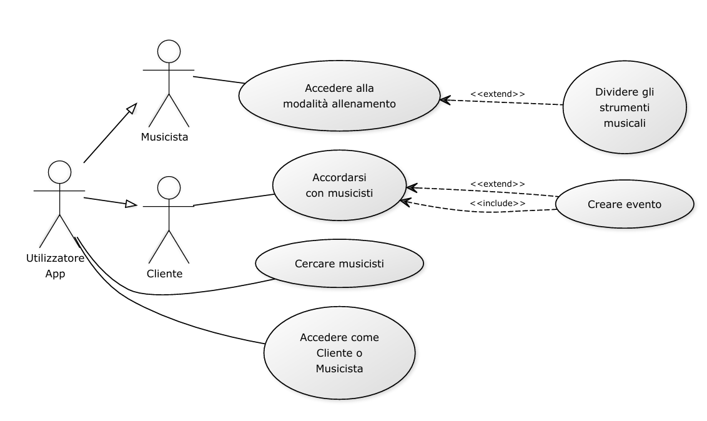

# BandMeet

## Trova la tua band, trova il tuo palco

## Descrizione

App per la gestione della musica dal vivo, divisa in due tipi di account: “Musicista” e “Organizzatore e/o Partecipante”. Inoltre, la piattaforma permette agli artisti sia di cercare altri membri per completare o formare la propria band, sia di avere una vetrina pubblica. Nella vetrina è possibile incorporare i link esterni a Spotify, YouTube, Instagram e SoundCloud, così da ascoltare e guardare i contenuti dell’artista direttamente dal profilo. Il sistema di matching intelligente suggerisce ai musicisti i profili più adatti a completare una band, in base a genere, strumento mancante, zona e disponibilità. Prima di entrare ufficialmente in una band, i musicisti possono usare una sezione dedicata alle prove di compatibilità, dove inserire audio e video demo, inviare una “jam request” o ricevere un invito a una prova di prova. Anche le band hanno un proprio profilo pubblico e possono essere cercate dai clienti e dagli altri musicisti. I musicisti e le band possono essere seguiti dagli utenti, che ricevono una notifica quando l’artista pubblica una data nella loro zona. Ogni profilo può ottenere un badge di verifica, assegnato ai musicisti con esibizioni reali concluse sulla piattaforma, in modo che le recensioni siano sempre legate a eventi effettivamente avvenuti. I clienti possono navigare tra i profili dei musicisti e delle band per contattarli e ingaggiarli, oppure pubblicare una proposta d’evento visibile solo ai musicisti, che possono farsi avanti. Le trattative avvengono tramite offerte e controfferte in una chat dedicata, che si conclude con un “accordo” formale all’interno dell’app. L’accordo prevede una politica di cancellazione chiara, con penali progressive e la possibilità di sostituzione automatica con un artista simile. Al termine dell’evento le recensioni sono bidirezionali: i clienti valutano gli artisti e gli artisti valutano gli organizzatori. Quando un musicista accetta un ingaggio, l’app gestisce i conflitti e lo avvisa se è già impegnato in quella data o se ha un altro evento troppo vicino. Una volta trovato un accordo, l’evento può essere pubblicato come privato (compleanni, matrimoni) o pubblico (concerti in locali o piazze) visibile a tutti gli utenti della zona. Gli eventi pubblici sono consultabili su una mappa degli eventi vicino a te, con filtri per genere, prezzo, data, “stasera” e “questo weekend”. L’accesso agli eventi con biglietto è controllato tramite QR code, con modalità offline per il gestore. A un evento può esibirsi una band oppure un musicista singolo; quando nello stesso evento si esibiscono più musicisti o band, l’evento prende il nome di maxi-evento. I musicisti e le band possono anche creare autonomamente un proprio evento pubblico senza accordi preventivi; in questo caso, se a una settimana dall’inizio non viene raggiunta una soglia minima di partecipanti impostata dall’artista, il sistema cancella automaticamente la serata. Per aiutare a raggiungere la soglia, gli utenti possono usare la funzione “Serata a rischio”: prenotano un posto senza pagare subito e confermano l’acquisto solo quando la soglia è vicina. L’app copre così l’intero ciclo musicale: dalla nascita della band fino al palco e alla vendita dei biglietti.

### Per i musicisti

- **Ricerca di membri**: la piattaforma permette di cercare altri musicisti per completare o formare la propria band.
- **Matching intelligente**: suggerimenti dei profili più adatti a completare una band, in base a genere, strumento mancante, zona e disponibilità.
- **Prove di compatibilità**: prima di entrare in una band, si possono inserire audio e video demo, inviare una "jam request" o ricevere un invito a una prova.
- **Vetrina pubblica**: ogni artista può avere un profilo pubblico in cui mostrarsi, con link incorporati a Spotify, YouTube, Instagram e SoundCloud.
- **Profilo di band**: anche le band hanno un proprio profilo pubblico e possono essere cercate.
- **Badge di verifica**: assegnato ai musicisti con esibizioni reali concluse sulla piattaforma.
- **Gestione dei conflitti di calendario**: avviso se si accetta un ingaggio in una data già impegnata o troppo vicina a un altro evento.
- **Eventi autonomi**: i musicisti e le band possono creare un proprio evento pubblico senza accordi preventivi. Se a una settimana dall'inizio non viene raggiunta la soglia minima di partecipanti impostata dall'artista, il sistema cancella automaticamente la serata.

### Per i organizzatori/partecipanti

- **Esplorazione dei profili**: possono navigare tra i profili dei musicisti e delle band per contattarli e ingaggiarli.
- **Proposte d'evento**: possono pubblicare una proposta d'evento visibile solo ai musicisti, che possono farsi avanti.
- **Trattativa e accordo**: offerte e controfferte in una chat dedicata, fino a un accordo formale con politica di cancellazione (penali progressive e sostituzione automatica con un artista simile).
- **Recensioni**: al termine dell'evento i clienti valutano gli artisti.
- **Seguire gli artisti**: notifica quando un musicista o una band pubblica una data nella propria zona.
- **Mappa degli eventi**: eventi pubblici vicino a te, con filtri per genere, prezzo, data, "stasera" e "questo weekend".
- **Serata a rischio**: prenotazione di un posto senza pagare subito, con conferma dell'acquisto quando la soglia è vicina.
- **Eventi**: una volta trovato un accordo, l'evento può essere pubblicato come:
  - **Privato** (compleanni, matrimoni)
  - **Pubblico** (concerti in locali o piazze), visibile a tutti gli utenti della zona
- **Maxi-evento**: quando nello stesso evento si esibiscono più musicisti o band.

## Il problema che risolve

Chi fa musica dal vivo oggi usa strumenti separati e scollegati per ogni fase: trovare i membri della band, cercare ingaggi, organizzare l'evento e vendere i biglietti. Chi cerca musica per un evento, invece, non ha un posto dove trovare e ingaggiare i musicisti in modo semplice.

L'app risolve questo problema riunendo tutto in un'unica piattaforma: ricerca di band e musicisti, ingaggi, eventi e biglietteria, con in più una protezione per l'artista (la soglia minima di partecipanti) che evita di fare serate in perdita.

## Target

- Musicisti in cerca di altri musicisti
- Persone in cerca di musicisti per eventi
- Persone in cerca di eventi musicali nelle vicinanze

## Competitor

- Moises AI
- BandLab
- Vampr
- iKonX
- Giggster
- Eventbrite

## Il ciclo completo

L'app copre l'intero ciclo musicale: dalla nascita della band e le prove, fino al palco e alla vendita dei biglietti.

```
Band → Prove di compatibilità → Ingaggio → Evento → Biglietti
```

## Attori

| Attore | Tipo | Descrizione |
|--------|------|-------------|
| Partecipante | Primario | Persona che può consultare il feed degli eventi pubblici della propria zona. |
| Musicista | Primario | Utente registrato con account "Musicista": crea la vetrina pubblica, cerca membri per la band, riceve proposte di ingaggio e pubblica eventi autonomi. |
| Organizzatore| Primario | Utente registrato con account "Cliente": naviga tra le vetrine dei musicisti, propone ingaggi, crea eventi privati o pubblici concordati e acquista i biglietti. |
| Gestore dell'evento | Secondario | Verifica l'accesso degli ospiti scansionando i QR code dei biglietti, anche in modalità offline. |
| Sistema automatizzato | Di sistema | Esegue le operazioni automatiche: controllo a 7 giorni dall'evento, cancellazione sotto soglia, notifiche, rimborsi, suggerimenti di matching e sostituzione artista. |
| Amministratore | Secondario | Gestisce la piattaforma, il controllo degli accessi, l'assegnazione dei badge di verifica e la moderazione di utenti e contenuti. |
| Provider di pagamento (es. Stripe) | Esterno | Servizio esterno certificato PCI-DSS che gestisce pagamenti e rimborsi. |
| Servizi esterni (Spotify, YouTube, Instagram, SoundCloud) | Esterno | Piattaforme da cui vengono incorporati i contenuti nelle vetrine degli artisti. |

## Tipi di account

| Funzionalità                           | Musicista | Organizzatore/Partecipante |
|----------------------------------------|:---------:|:-------:|
| Ricerca e formazione della band        | Sì | No |
| Vetrina pubblica                       | Sì | No |
| Creazione di eventi autonomi           | Sì | No |
| Navigazione dei profili musicisti      | Sì | Sì |
| Ingaggio di musicisti                  | No | Sì |
| Visualizzazione eventi della zona      | Sì | Sì |
| Matching intelligente e prove di compatibilità | Sì | No |
| Profilo di band                        | Sì | No |
| Pubblicazione di proposte d'evento     | No | Sì |
| Trattativa in chat e accordo           | Sì | Sì |
| Seguire musicisti e band               | Sì | Sì |
| Recensioni bidirezionali               | Sì | Sì |
| Acquisto biglietti e "Serata a rischio"| No | Sì |

## Requisiti funzionali

### Epica 1: Gestione Account e Profili

| ID | Requisito | Origine |
|----|-----------|---------|
| RF-1.1 | Il sistema deve permettere la registrazione di un nuovo utente, con scelta obbligatoria del ruolo (Musicista o Cliente). | US1.1 |
| RF-1.2 | Il sistema deve creare il profilo specifico per il ruolo scelto e mostrare la dashboard corrispondente. | US1.1 |
| RF-1.3 | Il musicista deve poter creare e modificare il proprio profilo pubblico, indicando strumenti suonati, genere e bio. | US1.2 |
| RF-1.4 | Il profilo del musicista deve essere visibile e navigabile pubblicamente all'interno dell'app. | US1.2 |
| RF-1.5 | Il musicista deve poter cercare altri artisti filtrando per strumento o genere. | US1.3 |
| RF-1.6 | Il musicista deve poter incorporare nella vetrina i link a Spotify, YouTube, Instagram e SoundCloud. | US1.4 |
| RF-1.7 | Il sistema deve riprodurre i contenuti incorporati direttamente dal profilo. | US1.4 |
| RF-1.8 | Il sistema deve suggerire al musicista i profili più adatti a completare una band, in base a genere, strumento mancante, zona e disponibilità. | US1.5 |
| RF-1.9 | Il musicista deve poter caricare audio e video demo in una sezione dedicata alle prove di compatibilità. | US1.6 |
| RF-1.10 | Il musicista deve poter inviare e ricevere una "jam request" e inviti a una prova prima di entrare in una band. | US1.6 |
| RF-1.11 | Una band deve avere un proprio profilo pubblico, cercabile da clienti e musicisti. | US1.7 |
| RF-1.12 | L'utente deve poter seguire musicisti e band. | US1.8 |
| RF-1.13 | Il sistema deve notificare chi segue un artista quando questo pubblica una data nella sua zona. | US1.8 |
| RF-1.14 | Il sistema deve assegnare un badge di verifica ai musicisti con esibizioni reali concluse sulla piattaforma. | US1.9 |

#### US1.1 – Registrazione e scelta del ruolo
**Come** nuovo membro della piattaforma,
**voglio** potermi registrare e scegliere se creare un account "Musicista" o "Cliente",
**in modo da** accedere alle funzionalità specifiche per le mie esigenze musicali.

**Criteri di accettazione**
- **Given** un nuovo membro si trova nella schermata di registrazione
- **When** inserisce i dati richiesti e seleziona esplicitamente il ruolo
- **Then** il sistema crea il profilo specifico e mostra la dashboard corretta in base alla scelta effettuata

#### US1.2 – Vetrina pubblica del musicista
**Come** Musicista,
**voglio** creare e personalizzare il mio profilo pubblico,
**in modo da** mostrare le mie competenze, la mia musica e farmi trovare da altri artisti o potenziali clienti.

**Criteri di accettazione**
- Il profilo include dettagli come strumenti suonati, genere e bio
- Il profilo salvato è visibile e navigabile pubblicamente all'interno dell'applicazione

#### US1.3 – Ricerca membri per la band
**Come** Musicista,
**voglio** cercare altri artisti filtrando per strumento o genere,
**in modo da** trovare i membri mancanti per completare o formare la mia band.

#### US1.4 – Link esterni nella vetrina
**Come** Musicista,
**voglio** incorporare nella mia vetrina i link a Spotify, YouTube, Instagram e SoundCloud,
**in modo da** far ascoltare e guardare i miei contenuti direttamente dal profilo.

**Criteri di accettazione**
- **Given** il musicista inserisce un link valido di una delle piattaforme supportate
- **When** salva il profilo
- **Then** il contenuto è riproducibile o visibile direttamente dalla vetrina

#### US1.5 – Matching intelligente
**Come** Musicista,
**voglio** ricevere suggerimenti dei profili più adatti a completare la mia band,
**in modo da** trovare più in fretta i membri giusti.

**Criteri di accettazione**
- I suggerimenti tengono conto di genere, strumento mancante, zona e disponibilità

#### US1.6 – Prove di compatibilità
**Come** Musicista,
**voglio** inserire audio e video demo, inviare una "jam request" o ricevere un invito a una prova prima di entrare in una band,
**in modo da** verificare l'intesa musicale prima di impegnarmi.

#### US1.7 – Profilo di band
**Come** Musicista,
**voglio** che la mia band abbia un profilo pubblico,
**in modo da** farla trovare da clienti e altri musicisti.

#### US1.8 – Seguire artisti e ricevere notifiche
**Come** utente,
**voglio** seguire musicisti e band,
**in modo da** ricevere una notifica quando pubblicano una data nella mia zona.

#### US1.9 – Badge di verifica
**Come** Musicista,
**voglio** ottenere un badge di verifica dopo esibizioni reali concluse sulla piattaforma,
**in modo da** dimostrare affidabilità e rendere le recensioni legate a eventi effettivamente avvenuti.

### Epica 2: Ingaggio e Organizzazione Eventi

| ID | Requisito | Origine |
|----|-----------|---------|
| RF-2.1 | Il Cliente deve poter navigare tra le vetrine dei musicisti e contattarli direttamente. | US2.1 |
| RF-2.2 | Il Cliente deve poter inviare una proposta di ingaggio, e le parti devono poter trattare fino all'accettazione dell'accordo. | US2.1 |
| RF-2.3 | Dopo l'accordo, il sistema deve permettere di creare un evento specificando se è Privato o Pubblico. | US2.2 |
| RF-2.4 | Gli eventi Privati non devono comparire nei feed geografici visibili agli altri utenti. | US2.2 |
| RF-2.5 | Il musicista deve poter pubblicare autonomamente un evento pubblico, senza ingaggio preventivo, indicando data, luogo, prezzo e soglia minima di partecipanti. | US2.3 |
| RF-2.6 | Prima della pubblicazione di un evento autonomo, il sistema deve avvisare il musicista della regola di cancellazione automatica. | US2.3 |
| RF-2.7 | Il Cliente deve poter pubblicare una proposta d'evento visibile solo ai musicisti. | US2.4 |
| RF-2.8 | I musicisti devono poter rispondere a una proposta d'evento facendosi avanti. | US2.4 |
| RF-2.9 | Il sistema deve offrire una chat dedicata in cui scambiare offerte e controfferte. | US2.5 |
| RF-2.10 | La trattativa deve concludersi con un "accordo" formale registrato nell'app. | US2.5 |
| RF-2.11 | L'accordo deve includere una politica di cancellazione con penali progressive. | US2.6 |
| RF-2.12 | In caso di cancellazione, il sistema deve proporre la sostituzione automatica con un artista simile. | US2.6 |
| RF-2.13 | Quando un musicista accetta un ingaggio, il sistema deve avvisarlo se è già impegnato in quella data o ha un altro evento troppo vicino. | US2.7 |
| RF-2.14 | Al termine dell'evento, il Cliente deve poter valutare l'artista e l'artista valutare l'organizzatore. | US2.8 |
| RF-2.15 | Le recensioni devono essere collegate a eventi effettivamente conclusi sulla piattaforma. | US2.8 |
| RF-2.16 | Un evento può avere come artista una band o un musicista singolo. | US2.9 |
| RF-2.17 | Un evento con più musicisti o band deve essere classificato come maxi-evento. | US2.9 |

#### US2.1 – Contatto e ingaggio artisti
**Come** Cliente,
**voglio** navigare tra le vetrine dei musicisti e contattarli direttamente,
**in modo da** proporre un ingaggio e raggiungere un accordo per una serata.

#### US2.2 – Pubblicazione evento privato o pubblico (concordato)
**Come** Cliente (o Musicista dopo l'accordo),
**voglio** creare un evento specificando se è "Privato" o "Pubblico",
**in modo da** gestire la visibilità del concerto (solo invitati o intera community locale).

**Criteri di accettazione**
- Se l'evento è "Privato", non deve apparire nei feed geografici visibili agli altri utenti

#### US2.3 – Creazione autonoma di un evento pubblico
**Come** Musicista,
**voglio** pubblicare un evento pubblico autonomamente senza un ingaggio preventivo,
**in modo da** pianificare i miei concerti direttamente nei locali o nelle piazze.

#### US2.4 – Proposta d'evento
**Come** Cliente,
**voglio** pubblicare una proposta d'evento visibile solo ai musicisti,
**in modo da** ricevere le candidature degli artisti interessati.

**Criteri di accettazione**
- La proposta non è visibile agli utenti non musicisti
- I musicisti possono farsi avanti e il Cliente vede le candidature

#### US2.5 – Trattativa tramite offerte e controfferte
**Come** Cliente o Musicista,
**voglio** scambiare offerte e controfferte in una chat dedicata,
**in modo da** arrivare a un accordo formale all'interno dell'app.

#### US2.6 – Politica di cancellazione e sostituzione
**Come** Cliente,
**voglio** che l'accordo preveda penali progressive e la sostituzione automatica con un artista simile,
**in modo da** essere tutelato in caso di cancellazione dell'artista.

#### US2.7 – Gestione dei conflitti di calendario
**Come** Musicista,
**voglio** essere avvisato se accetto un ingaggio in una data già impegnata o troppo vicina a un altro evento,
**in modo da** evitare sovrapposizioni.

#### US2.8 – Recensioni bidirezionali
**Come** Cliente o Musicista,
**voglio** lasciare una recensione al termine dell'evento,
**in modo da** costruire reputazione affidabile da entrambe le parti.

**Criteri di accettazione**
- La recensione è possibile solo dopo un evento concluso sulla piattaforma

#### US2.9 – Maxi-evento
**Come** Cliente o Musicista,
**voglio** creare un evento in cui si esibiscono più musicisti o band,
**in modo da** organizzare serate con più artisti (maxi-evento).

### Epica 3: Distribuzione, Biglietteria e Automazioni

| ID | Requisito | Origine |
|----|-----------|---------|
| RF-3.1 | Il sistema deve mostrare una lista o una mappa degli eventi pubblici filtrata in base alla posizione dell'utente. | US3.1 |
| RF-3.2 | Il Cliente deve poter acquistare i biglietti di un evento pubblico direttamente dall'app. | US3.2 |
| RF-3.3 | Dopo l'acquisto, il sistema deve emettere un titolo di accesso digitale con codice univoco (QR). | US3.2 |
| RF-3.4 | Il sistema deve controllare automaticamente i biglietti venduti degli eventi auto-organizzati a 7 giorni dall'inizio. | US3.3 |
| RF-3.5 | Se i biglietti venduti sono inferiori alla soglia minima, il sistema deve cancellare l'evento e notificare l'artista e chi aveva prenotato. | US3.3 |
| RF-3.6 | In caso di cancellazione automatica, il sistema deve avviare il rimborso a tutti i partecipanti. | US3.3 |
| RF-3.7 | La mappa degli eventi deve offrire filtri per genere, prezzo, data, "stasera" e "questo weekend". | US3.4 |
| RF-3.8 | Il gestore deve poter verificare i biglietti scansionando il QR code all'ingresso. | US3.5 |
| RF-3.9 | L'app del gestore deve funzionare anche offline e sincronizzare i dati alla riconnessione. | US3.5 |
| RF-3.10 | Il sistema deve permettere di prenotare un posto a un evento sotto soglia senza pagare subito ("Serata a rischio"). | US3.6 |
| RF-3.11 | Il sistema deve chiedere la conferma dell'acquisto quando la soglia è vicina. | US3.6 |

#### US3.1 – Feed eventi su base locale
**Come** Visitatore della piattaforma,
**voglio** visualizzare una lista o mappa degli eventi pubblici filtrata in base alla mia posizione,
**in modo da** scoprire i concerti attivi nella mia zona.

#### US3.2 – Acquisto biglietti
**Come** Cliente,
**voglio** acquistare i biglietti per un evento pubblico direttamente dall'app,
**in modo da** assicurarmi l'ingresso alla serata e ricevere il titolo di accesso digitale.

#### US3.3 – Cancellazione automatica per mancato raggiungimento soglia
**Come** Sistema automatizzato,
**voglio** monitorare le prenotazioni degli eventi auto-organizzati a 7 giorni dall'inizio,
**in modo da** cancellare automaticamente la serata se i partecipanti sono inferiori alla soglia minima impostata dal musicista.

**Criteri di accettazione**
- **Given** un concerto auto-organizzato ha impostato una soglia di 50 partecipanti
- **When** mancano esattamente 7 giorni all'inizio e i biglietti venduti sono 45
- **Then** il sistema cancella il concerto, invia una notifica all'artista e a chi aveva prenotato, e avvia le procedure di rimborso economico

#### US3.4 – Mappa degli eventi con filtri
**Come** Partecipante,
**voglio** consultare una mappa degli eventi vicino a me con filtri per genere, prezzo, data, "stasera" e "questo weekend",
**in modo da** trovare rapidamente la serata giusta.

#### US3.5 – Controllo accessi con QR code
**Come** Gestore dell'evento,
**voglio** scansionare i QR code dei biglietti anche senza connessione,
**in modo da** controllare gli ingressi in locali o piazze con rete scarsa.

**Criteri di accettazione**
- **Given** il gestore ha scaricato la lista dei biglietti validi
- **When** scansiona un QR code senza connessione
- **Then** il sistema segnala se il biglietto è valido e non già utilizzato, e sincronizza gli ingressi alla riconnessione

#### US3.6 – Serata a rischio
**Come** Partecipante,
**voglio** prenotare un posto senza pagare subito e confermare l'acquisto solo quando la soglia è vicina,
**in modo da** non spendere soldi per una serata che potrebbe essere cancellata.

## Requisiti non funzionali

| ID | Categoria | Descrizione |
|----|-----------|-------------|
| RNF-1 | Prestazioni | Le pagine principali si caricano in meno di 2 secondi. |
| RNF-2 | Scalabilità | Il sistema regge almeno 10.000 utenti simultanei, compresi i picchi all'apertura della vendita biglietti. |
| RNF-3 | Affidabilità | Disponibilità minima del 99,5% mensile, con backup giornalieri. Il job di cancellazione automatica degli eventi sotto soglia viene eseguito una sola volta per evento, con log e retry. |
| RNF-4 | Integrità dei pagamenti | Nessun doppio addebito e nessun biglietto venduto oltre la capienza, anche con acquisti concorrenti. |
| RNF-5 | Sicurezza | Comunicazioni cifrate (HTTPS), password con hashing robusto, controllo degli accessi per ruolo (Musicista / Cliente / Admin), protezione dalle vulnerabilità OWASP Top 10 e pagamenti tramite provider certificato PCI-DSS (es. Stripe). |
| RNF-6 | Privacy (GDPR) | Consenso esplicito, diritto di accesso e cancellazione dei dati, geolocalizzazione solo con consenso; i dettagli degli eventi privati sono visibili solo alle parti coinvolte. |
| RNF-7 | Usabilità e compatibilità | Interfaccia intuitiva (ingaggio di un musicista in al massimo 5 passaggi), responsive su iOS, Android e principali browser, in italiano e inglese. |
| RNF-8 | Funzionamento offline | La verifica dei QR code funziona senza connessione e sincronizza gli ingressi alla riconnessione, evitando che lo stesso biglietto sia accettato due volte. |
| RNF-9 | Comunicazioni in tempo reale | Chat di trattativa e notifiche (nuove date, conflitti di calendario, cancellazioni) sono recapitate entro pochi secondi. |
| RNF-10 | Affidabilità dei suggerimenti | Il matching intelligente restituisce i suggerimenti in meno di 3 secondi e spiega i criteri usati (genere, strumento, zona, disponibilità). |

## Requisiti di dominio

| ID | Ambito | Descrizione |
|----|--------|-------------|
| RD-1 | SIAE | Per gli eventi ppubblici la piattaforma ricorda all'organizzatore gli adempimenti SIAE (borderò e diritti). |
| RD-2 | Biglietteria | I biglietti rispettano la normativa italiana (titolo di accesso, IVA, QR code univoco e non duplicabile) e non superano mai la capienza dichiarata. |
| RD-3 | Rimborsi | In caso di cancellazione automatica dell'evento, tutti i partecipanti ricevono il rimborso integrale automatico. |
| RD-4 | Account ed eventi | Esistono due tipi di account (Musicista, Cliente) e due tipi di evento: privato (visibile solo alle parti, senza biglietti) e pubblico (visibile agli utenti della zona, con biglietti). |
| RD-5 | Ciclo di ingaggio | Richiesta → trattativa → accordo → pubblicazione: l'evento nasce solo dopo l'accettazione di entrambe le parti. |
| RD-6 | Evento autonomo con soglia | L'artista fissa soglia minima e prezzo; a 7 giorni dall'inizio, se i biglietti venduti sono sotto soglia, l'evento viene cancellato. L'artista è avvisato della regola prima di pubblicare e la soglia non è modificabile dopo la pubblicazione. |
| RD-7 | Band | Una band ha più membri con ruolo/strumento; un musicista può far parte di più band, con inviti, candidature e posizioni aperte. |
| RD-8 | Minori | Età minima di registrazione secondo GDPR e legge italiana (con consenso dei genitori sotto la soglia prevista). |
| RD-9 | Maxi-evento | Un evento con più musicisti o band è un maxi-evento; a un evento può esibirsi anche un solo musicista. |
| RD-10 | Accordo e cancellazione | L'accordo formale fissa compenso e politica di cancellazione con penali progressive; in caso di rinuncia dell'artista il sistema propone un sostituto simile. |
| RD-11 | Recensioni verificate | Le recensioni sono bidirezionali e ammesse solo per eventi conclusi sulla piattaforma; il badge di verifica spetta solo ai musicisti con esibizioni reali concluse. |
| RD-12 | Proposte d'evento | Le proposte d'evento sono visibili solo ai musicisti e restano separate dagli eventi pubblicati. |
| RD-13 | Serata a rischio | La prenotazione senza pagamento non garantisce l'ingresso: il biglietto è valido solo dopo la conferma dell'acquisto; la prenotazione non conta per la capienza oltre una scadenza definita. |
| RD-14 | Contenuti esterni | I link a Spotify, YouTube, Instagram e SoundCloud sono solo incorporati: i contenuti restano di proprietà dei rispettivi autori e piattaforme. |


## Diagramma Use Case



