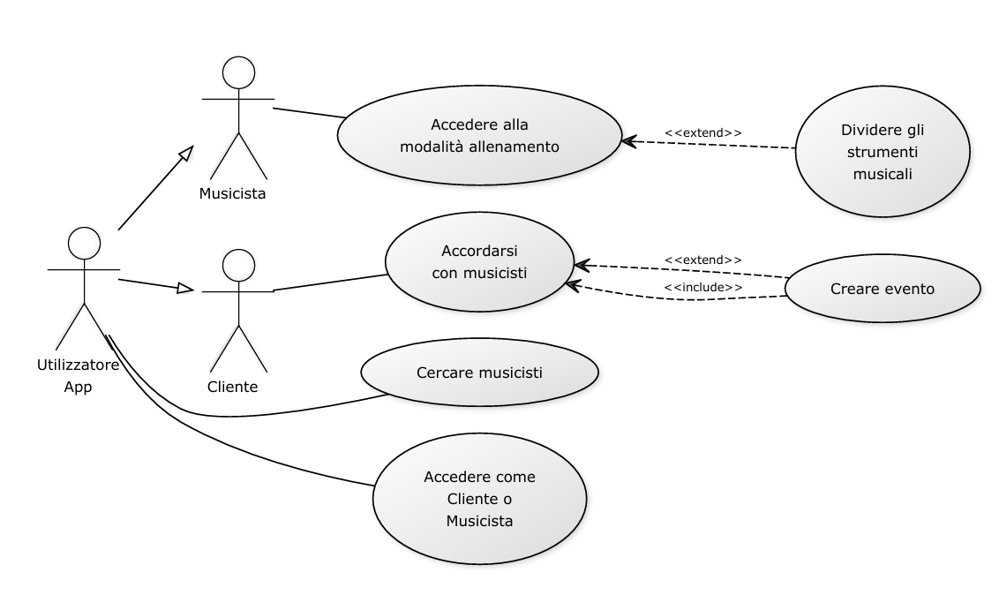

# BandMeet

## Dalle prove al palco, tutto in un'unica piattaforma.

## Descrizione

App che unisce l'Intelligenza Artificiale alla gestione della musica dal vivo, divisa in due tipi di account: "Musicista" e "Cliente". Per i musicisti, l'app offre una sezione di allenamento con un'IA che divide automaticamente qualsiasi brano nei singoli strumenti e voce, permettendo a ogni membro della band di isolare o silenziare la propria parte per studiarla al meglio. Inoltre, la piattaforma permette agli artisti sia di cercare altri membri per completare o formare la propria band, sia di avere una vetrina pubblica. I clienti possono navigare tra i profili dei musicisti per contattarli e ingaggiarli. Una volta trovato un accordo, l'evento può essere pubblicato come privato (compleanni, matrimoni) o pubblico (concerti in locali o piazze) visibile a tutti gli utenti della zona. I musicisti possono anche creare autonomamente un proprio evento pubblico senza accordi preventivi; in questo caso, se a una settimana dall'inizio non viene raggiunta una soglia minima di partecipanti impostata dall'artista, il sistema cancella automaticamente la serata. L'app copre così l'intero ciclo musicale: dalla nascita della band e le prove, fino al palco e alla vendita dei biglietti.

### Per i musicisti

- **Allenamento con IA**: una sezione che divide automaticamente qualsiasi brano nei singoli strumenti e voce, permettendo a ogni membro della band di isolare o silenziare la propria parte per studiarla al meglio.
- **Ricerca di membri**: la piattaforma permette di cercare altri musicisti per completare o formare la propria band.
- **Vetrina pubblica**: ogni artista può avere un profilo pubblico in cui mostrarsi.
- **Eventi autonomi**: i musicisti possono creare un proprio evento pubblico senza accordi preventivi. Se a una settimana dall'inizio non viene raggiunta la soglia minima di partecipanti impostata dall'artista, il sistema cancella automaticamente la serata.

### Per i clienti

- **Esplorazione dei profili**: possono navigare tra i profili dei musicisti per contattarli e ingaggiarli.
- **Eventi**: una volta trovato un accordo, l'evento può essere pubblicato come:
  - **Privato** (compleanni, matrimoni)
  - **Pubblico** (concerti in locali o piazze), visibile a tutti gli utenti della zona

## Il problema che risolve

Chi fa musica dal vivo oggi usa strumenti separati e scollegati per ogni fase: studiare i brani, trovare i membri della band, cercare ingaggi, organizzare l'evento e vendere i biglietti. Chi cerca musica per un evento, invece, non ha un posto dove trovare e ingaggiare i musicisti in modo semplice.

L'app risolve questo problema riunendo tutto in un'unica piattaforma: allenamento con IA, ricerca di band e musicisti, ingaggi, eventi e biglietteria, con in più una protezione per l'artista (la soglia minima di partecipanti) che evita di fare serate in perdita.

## Target

- Musicisti in cerca di altri musicisti
- Musicisti che vogliono imparare canzoni
- Persone in cerca di musicisti per eventi

## Competitor

- Moises AI
- BandLab
- Vampr
- iKonX
- Giggster
- Eventbrite

## Il ciclo completo

L'app copre l'intero ciclo musicale: dalla nascita della band e le prove, fino al palco e alla vendita dei biglietti.

```
Band → Prove → Ingaggio → Evento → Biglietti
```

## Attori

| Attore | Tipo | Descrizione |
|--------|------|-------------|
| Visitatore | Primario | Persona non registrata che può consultare il feed degli eventi pubblici della propria zona. |
| Musicista | Primario | Utente registrato con account "Musicista": usa la sezione di allenamento con IA, crea la vetrina pubblica, cerca membri per la band, riceve proposte di ingaggio e pubblica eventi autonomi. |
| Cliente | Primario | Utente registrato con account "Cliente": naviga tra le vetrine dei musicisti, propone ingaggi, crea eventi privati o pubblici concordati e acquista i biglietti. |
| Sistema automatizzato | Di sistema | Esegue le operazioni automatiche, come il controllo a 7 giorni dall'evento, la cancellazione sotto soglia, le notifiche e l'avvio dei rimborsi. |
| Amministratore | Secondario | Gestisce la piattaforma, il controllo degli accessi e la moderazione di utenti e contenuti. |
| Provider di pagamento (es. Stripe) | Esterno | Servizio esterno certificato PCI-DSS che gestisce pagamenti e rimborsi. |

## Tipi di account

| Funzionalità                           | Musicista | Cliente |
|----------------------------------------|:---------:|:-------:|
| Allenamento con IA (separazione brani) | Sì | No |
| Ricerca e formazione della band        | Sì | No |
| Vetrina pubblica                       | Sì | No |
| Creazione di eventi autonomi           | Sì | No |
| Navigazione dei profili musicisti      | Sì | Sì |
| Ingaggio di musicisti                  | No | Sì |
| Visualizzazione eventi della zona      | Sì | Sì |

## Requisiti funzionali

### Epica 1: Gestione Account e Profili

| ID | Requisito | Origine |
|----|-----------|---------|
| RF-1.1 | Il sistema deve permettere la registrazione di un nuovo utente, con scelta obbligatoria del ruolo (Musicista o Cliente). | US1.1 |
| RF-1.2 | Il sistema deve creare il profilo specifico per il ruolo scelto e mostrare la dashboard corrispondente. | US1.1 |
| RF-1.3 | Il musicista deve poter creare e modificare il proprio profilo pubblico, indicando strumenti suonati, genere e bio. | US1.2 |
| RF-1.4 | Il profilo del musicista deve essere visibile e navigabile pubblicamente all'interno dell'app. | US1.2 |
| RF-1.5 | Il musicista deve poter cercare altri artisti filtrando per strumento o genere. | US1.3 |

#### US1.1 – Registrazione e scelta del ruolo
**Come** nuovo membro della piattaforma,
**voglio** potermi registrare e scegliere se creare un account "Musicista" o "Cliente",
**in modo da** accedere alle funzionalità specifiche per le mie esigenze musicali.

**Criteri di accettazione**
- **Given** un nuovo membro si trova nella schermata di registrazione
- **When** inserisce i dati richiesti e seleziona esplicitamente il ruolo
- **Then** il sistema crea il profilo specifico e mostra la dashboard corretta in base alla scelta effettuata

#### US1.2 – Vetrina pubblica del musicista
**Come** Musicista,
**voglio** creare e personalizzare il mio profilo pubblico,
**in modo da** mostrare le mie competenze, la mia musica e farmi trovare da altri artisti o potenziali clienti.

**Criteri di accettazione**
- Il profilo include dettagli come strumenti suonati, genere e bio
- Il profilo salvato è visibile e navigabile pubblicamente all'interno dell'applicazione

#### US1.3 – Ricerca membri per la band
**Come** Musicista,
**voglio** cercare altri artisti filtrando per strumento o genere,
**in modo da** trovare i membri mancanti per completare o formare la mia band.

### Epica 2: Sezione Allenamento (IA)

| ID | Requisito | Origine |
|----|-----------|---------|
| RF-2.1 | Il musicista deve poter caricare un file audio dal proprio dispositivo nella sezione allenamento. | US2.1 |
| RF-2.2 | Il sistema deve separare tramite IA il brano in tracce isolate e indipendenti (voce, chitarra, batteria, basso, ecc.). | US2.1 |
| RF-2.3 | Il sistema deve mostrare lo stato di avanzamento dell'elaborazione e notificare il completamento o eventuali errori. | US2.1 |
| RF-2.4 | Il sistema deve offrire un player multitraccia che riproduce le tracce separate in modo sincronizzato. | US2.2 |
| RF-2.5 | Il musicista deve poter isolare (solo) o silenziare (mute) ogni singola traccia durante la riproduzione. | US2.2 |

#### US2.1 – Separazione tracce audio tramite IA
**Come** Musicista,
**voglio** caricare un qualsiasi brano musicale nella sezione allenamento,
**in modo da** far separare automaticamente dall'IA la voce e i singoli strumenti in tracce isolate.

**Criteri di accettazione**
- **Given** il musicista seleziona un file audio dal proprio dispositivo
- **When** avvia l'elaborazione
- **Then** l'IA genera tracce separate e indipendenti (es. Voce, Chitarra, Batteria, Basso)

#### US2.2 – Mixer per lo studio (isolamento/mute)
**Come** Musicista,
**voglio** isolare (solo) o silenziare (mute) le singole tracce estratte dall'IA durante la riproduzione,
**in modo da** studiare la mia parte o suonare sopra la base senza il mio strumento.

### Epica 3: Ingaggio e Organizzazione Eventi

| ID | Requisito | Origine |
|----|-----------|---------|
| RF-3.1 | Il Cliente deve poter navigare tra le vetrine dei musicisti e contattarli direttamente. | US3.1 |
| RF-3.2 | Il Cliente deve poter inviare una proposta di ingaggio, e le parti devono poter trattare fino all'accettazione dell'accordo. | US3.1 |
| RF-3.3 | Dopo l'accordo, il sistema deve permettere di creare un evento specificando se è Privato o Pubblico. | US3.2 |
| RF-3.4 | Gli eventi Privati non devono comparire nei feed geografici visibili agli altri utenti. | US3.2 |
| RF-3.5 | Il musicista deve poter pubblicare autonomamente un evento pubblico, senza ingaggio preventivo, indicando data, luogo, prezzo e soglia minima di partecipanti. | US3.3 |
| RF-3.6 | Prima della pubblicazione di un evento autonomo, il sistema deve avvisare il musicista della regola di cancellazione automatica. | US3.3 |

#### US3.1 – Contatto e ingaggio artisti
**Come** Cliente,
**voglio** navigare tra le vetrine dei musicisti e contattarli direttamente,
**in modo da** proporre un ingaggio e raggiungere un accordo per una serata.

#### US3.2 – Pubblicazione evento privato o pubblico (concordato)
**Come** Cliente (o Musicista dopo l'accordo),
**voglio** creare un evento specificando se è "Privato" o "Pubblico",
**in modo da** gestire la visibilità del concerto (solo invitati o intera community locale).

**Criteri di accettazione**
- Se l'evento è "Privato", non deve apparire nei feed geografici visibili agli altri utenti

#### US3.3 – Creazione autonoma di un evento pubblico
**Come** Musicista,
**voglio** pubblicare un evento pubblico autonomamente senza un ingaggio preventivo,
**in modo da** pianificare i miei concerti direttamente nei locali o nelle piazze.

### Epica 4: Distribuzione, Biglietteria e Automazioni

| ID | Requisito | Origine |
|----|-----------|---------|
| RF-4.1 | Il sistema deve mostrare una lista o una mappa degli eventi pubblici filtrata in base alla posizione dell'utente. | US4.1 |
| RF-4.2 | Il Cliente deve poter acquistare i biglietti di un evento pubblico direttamente dall'app. | US4.2 |
| RF-4.3 | Dopo l'acquisto, il sistema deve emettere un titolo di accesso digitale con codice univoco (QR). | US4.2 |
| RF-4.4 | Il sistema deve controllare automaticamente i biglietti venduti degli eventi auto-organizzati a 7 giorni dall'inizio. | US4.3 |
| RF-4.5 | Se i biglietti venduti sono inferiori alla soglia minima, il sistema deve cancellare l'evento e notificare l'artista e chi aveva prenotato. | US4.3 |
| RF-4.6 | In caso di cancellazione automatica, il sistema deve avviare il rimborso a tutti i partecipanti. | US4.3 |

#### US4.1 – Feed eventi su base locale
**Come** Visitatore della piattaforma,
**voglio** visualizzare una lista o mappa degli eventi pubblici filtrata in base alla mia posizione,
**in modo da** scoprire i concerti attivi nella mia zona.

#### US4.2 – Acquisto biglietti
**Come** Cliente,
**voglio** acquistare i biglietti per un evento pubblico direttamente dall'app,
**in modo da** assicurarmi l'ingresso alla serata e ricevere il titolo di accesso digitale.

#### US4.3 – Cancellazione automatica per mancato raggiungimento soglia
**Come** Sistema automatizzato,
**voglio** monitorare le prenotazioni degli eventi auto-organizzati a 7 giorni dall'inizio,
**in modo da** cancellare automaticamente la serata se i partecipanti sono inferiori alla soglia minima impostata dal musicista.

**Criteri di accettazione**
- **Given** un concerto auto-organizzato ha impostato una soglia di 50 partecipanti
- **When** mancano esattamente 7 giorni all'inizio e i biglietti venduti sono 45
- **Then** il sistema cancella il concerto, invia una notifica all'artista e a chi aveva prenotato, e avvia le procedure di rimborso economico

## Requisiti non funzionali

| ID | Categoria | Descrizione |
|----|-----------|-------------|
| RNF-1 | Prestazioni | Le pagine principali si caricano in meno di 2 secondi; la separazione di un brano di 5 minuti richiede al massimo 2 minuti, in modo asincrono con notifica al termine. |
| RNF-2 | Scalabilità | Il sistema regge almeno 10.000 utenti simultanei, compresi i picchi all'apertura della vendita biglietti; il modulo IA scala con code di job e worker on-demand. |
| RNF-3 | Affidabilità | Disponibilità minima del 99,5% mensile, con backup giornalieri. Il job di cancellazione automatica degli eventi sotto soglia viene eseguito una sola volta per evento, con log e retry. |
| RNF-4 | Integrità dei pagamenti | Nessun doppio addebito e nessun biglietto venduto oltre la capienza, anche con acquisti concorrenti. |
| RNF-5 | Sicurezza | Comunicazioni cifrate (HTTPS), password con hashing robusto, controllo degli accessi per ruolo (Musicista / Cliente / Admin), protezione dalle vulnerabilità OWASP Top 10 e pagamenti tramite provider certificato PCI-DSS (es. Stripe). |
| RNF-6 | Privacy (GDPR) | Consenso esplicito, diritto di accesso e cancellazione dei dati, geolocalizzazione solo con consenso; i dettagli degli eventi privati sono visibili solo alle parti coinvolte. |
| RNF-7 | Usabilità e compatibilità | Interfaccia intuitiva (ingaggio di un musicista in al massimo 5 passaggi), responsive su iOS, Android e principali browser, in italiano e inglese. |
| RNF-8 | Qualità audio e IA | Il player multitraccia mantiene le tracce sincronizzate (scarto < 20 ms) e applica mute/solo in modo quasi immediato; la separazione offre una qualità adeguata e mostra stato di avanzamento ed errori. |

## Requisiti di dominio

| ID | Ambito | Descrizione |
|----|--------|-------------|
| RD-1 | Diritto d'autore | La separazione dei brani è consentita solo per uso personale/didattico; le tracce separate non possono essere condivise pubblicamente. |
| RD-2 | SIAE | Per gli eventi pubblici la piattaforma ricorda all'organizzatore gli adempimenti SIAE (borderò e diritti). |
| RD-3 | Biglietteria | I biglietti rispettano la normativa italiana (titolo di accesso, IVA, QR code univoco e non duplicabile) e non superano mai la capienza dichiarata. |
| RD-4 | Rimborsi | In caso di cancellazione automatica dell'evento, tutti i partecipanti ricevono il rimborso integrale automatico. |
| RD-5 | Account ed eventi | Esistono due tipi di account (Musicista, Cliente) e due tipi di evento: privato (visibile solo alle parti, senza biglietti) e pubblico (visibile agli utenti della zona, con biglietti). |
| RD-6 | Ciclo di ingaggio | Richiesta → trattativa → accordo → pubblicazione: l'evento nasce solo dopo l'accettazione di entrambe le parti. |
| RD-7 | Evento autonomo con soglia | L'artista fissa soglia minima e prezzo; a 7 giorni dall'inizio, se i biglietti venduti sono sotto soglia, l'evento viene cancellato. L'artista è avvisato della regola prima di pubblicare e la soglia non è modificabile dopo la pubblicazione. |
| RD-8 | Band | Una band ha più membri con ruolo/strumento; un musicista può far parte di più band, con inviti, candidature e posizioni aperte. |
| RD-9 | Minori | Età minima di registrazione secondo GDPR e legge italiana (con consenso dei genitori sotto la soglia prevista). |

##Diagramma Use Case

